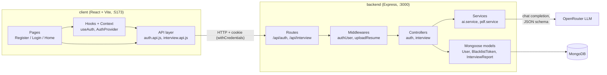

# InterviewPrep AI

A full-stack app that prepares you for a job interview. Paste a job description, upload your resume (PDF) and/or describe yourself, and an LLM generates a personalised interview report:

- **Match score** (0–100) for how well you fit the role
- **Technical and behavioral questions**, each with the interviewer's intention and a strong sample answer
- **Skill gaps** rated low / medium / high
- **Day-by-day preparation plan**

Reports are saved to MongoDB against the logged-in user.

## Tech stack

| Layer    | Technology |
|----------|------------|
| Frontend | React 19, Vite, React Router 7, Axios, Sass |
| Backend  | Node.js, Express 5 |
| Database | MongoDB with Mongoose |
| Auth     | JWT in an HTTP cookie, bcrypt password hashing, token blacklist on logout |
| AI       | OpenRouter chat completions API (free models) with strict JSON schema output |
| Uploads  | Multer (in-memory) + pdf-parse for resume text extraction |

## High-level architecture



The project is split into two independent apps that talk over HTTP:

- **`client/`** – a single-page React app. It never touches the database or the LLM directly; everything goes through the backend API.
- **`backend/`** – a REST API with a layered structure: **routes → middlewares → controllers → services / models**.

## Folder structure

```
genAI-project/
├── backend/
│   ├── server.js                  # Entry point: loads .env, connects to MongoDB, starts server on :3000
│   └── src/
│       ├── app.js                 # Express app: JSON, CORS (localhost:5173, credentials), cookies, routers
│       ├── config/database.js     # Mongoose connection (MONGO_URI)
│       ├── routes/
│       │   ├── auth.routes.js     # /api/auth/*
│       │   └── interview.routes.js# /api/interview
│       ├── middlewares/
│       │   ├── auth.middleware.js # Verifies JWT cookie, rejects blacklisted tokens, sets req.user
│       │   └── upload.middleware.js# Multer: optional "resume" PDF, max 5MB, kept in memory
│       ├── controllers/
│       │   ├── auth.controller.js # register, login, logout, getme
│       │   └── interview.controller.js # validates input, builds report, saves it
│       ├── services/
│       │   ├── ai.service.js      # Prompt + JSON schema, calls OpenRouter, parses the result
│       │   └── pdf.service.js     # Extracts plain text from a PDF buffer
│       └── models/
│           ├── user.model.js
│           ├── blacklist.model.js
│           └── InterviewReport.model.js
└── client/
    └── src/
        ├── main.jsx / App.jsx     # Mounts AuthProvider + RouterProvider
        ├── app.routes.jsx         # "/" Register, "/login" Login, "/home" Home (protected)
        ├── style.scss, style/     # Global styles and button styles
        └── features/
            ├── auth/
            │   ├── auth.context.jsx     # AuthProvider: current user + loading, fetched via getme on load
            │   ├── hooks/useAuth.js     # handleLogin / handleRegister / handleLogout
            │   ├── services/auth.api.js # Axios calls to /api/auth
            │   ├── components/Protected.jsx # Redirects to /login when not authenticated
            │   └── pages/               # Register, Login
            └── interview/
                ├── services/interview.api.js # Sends the form as multipart/form-data
                └── pages/Home.jsx            # Input form + rendered report
```

The frontend is organised **by feature**. Each feature owns its own API, hook/state, component and page layers.
