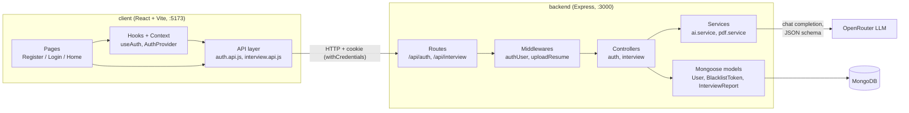
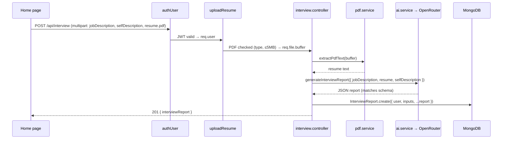
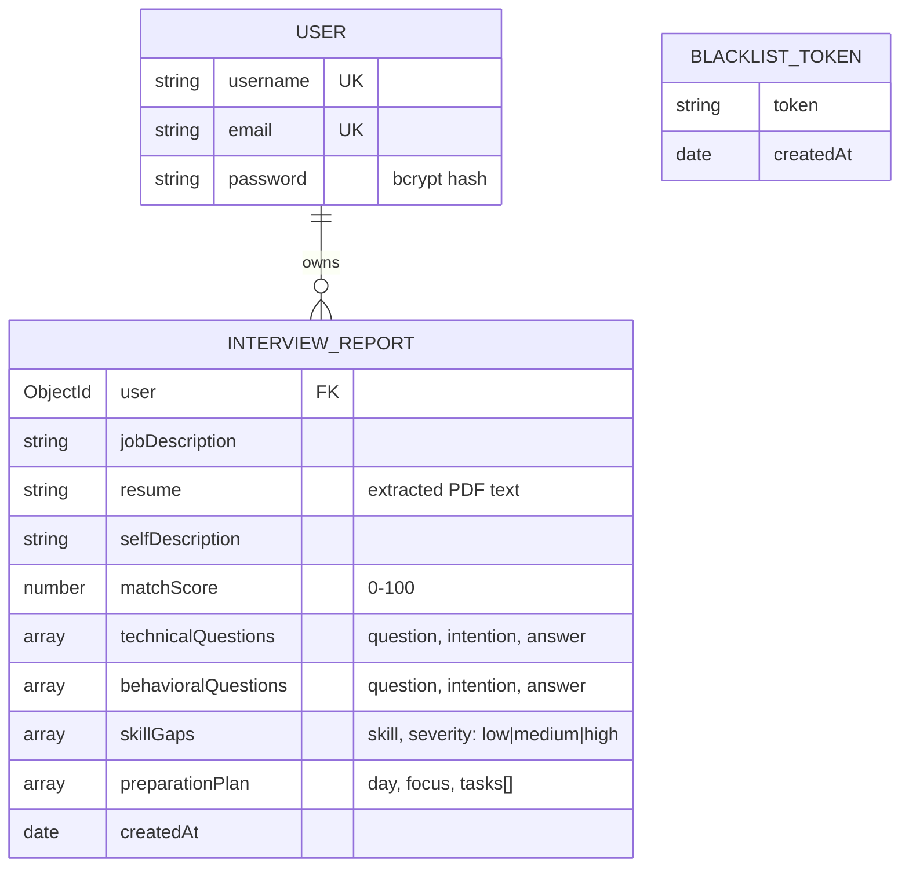

# InterviewPrep AI

A full-stack app that prepares you for a job interview. Paste a job description, upload your resume (PDF) and/or describe yourself, and an LLM generates a personalised interview report:

- **Match score** (0–100) for how well you fit the role
- **Technical and behavioral questions**, each with the interviewer's intention and a strong sample answer
- **Skill gaps** rated low / medium / high
- **Day-by-day preparation plan**

Reports are saved to MongoDB against the logged-in user.

## Tech stack

| Layer    | Technology |
|----------|------------|
| Frontend | React 19, Vite, React Router 7, Axios, Sass |
| Backend  | Node.js, Express 5 |
| Database | MongoDB with Mongoose |
| Auth     | JWT in an HTTP cookie, bcrypt password hashing, token blacklist on logout |
| AI       | OpenRouter chat completions API (free models) with strict JSON schema output |
| Uploads  | Multer (in-memory) + pdf-parse for resume text extraction |

## High-level architecture



The project is split into two independent apps that talk over HTTP:

- **`client/`** – a single-page React app. It never touches the database or the LLM directly; everything goes through the backend API.
- **`backend/`** – a REST API with a layered structure: **routes → middlewares → controllers → services / models**.

## Folder structure

```
genAI-project/
├── backend/
│   ├── server.js                  # Entry point: loads .env, connects to MongoDB, starts server on :3000
│   └── src/
│       ├── app.js                 # Express app: JSON, CORS (localhost:5173, credentials), cookies, routers
│       ├── config/database.js     # Mongoose connection (MONGO_URI)
│       ├── routes/
│       │   ├── auth.routes.js     # /api/auth/*
│       │   └── interview.routes.js# /api/interview
│       ├── middlewares/
│       │   ├── auth.middleware.js # Verifies JWT cookie, rejects blacklisted tokens, sets req.user
│       │   └── upload.middleware.js# Multer: optional "resume" PDF, max 5MB, kept in memory
│       ├── controllers/
│       │   ├── auth.controller.js # register, login, logout, getme
│       │   └── interview.controller.js # validates input, builds report, saves it
│       ├── services/
│       │   ├── ai.service.js      # Prompt + JSON schema, calls OpenRouter, parses the result
│       │   └── pdf.service.js     # Extracts plain text from a PDF buffer
│       └── models/
│           ├── user.model.js
│           ├── blacklist.model.js
│           └── InterviewReport.model.js
└── client/
    └── src/
        ├── main.jsx / App.jsx     # Mounts AuthProvider + RouterProvider
        ├── app.routes.jsx         # "/" Register, "/login" Login, "/home" Home (protected)
        ├── style.scss, style/     # Global styles and button styles
        └── features/
            ├── auth/
            │   ├── auth.context.jsx     # AuthProvider: current user + loading, fetched via getme on load
            │   ├── hooks/useAuth.js     # handleLogin / handleRegister / handleLogout
            │   ├── services/auth.api.js # Axios calls to /api/auth
            │   ├── components/Protected.jsx # Redirects to /login when not authenticated
            │   └── pages/               # Register, Login
            └── interview/
                ├── services/interview.api.js # Sends the form as multipart/form-data
                └── pages/Home.jsx            # Input form + rendered report
```

The frontend is organised **by feature**. Each feature owns its own API, hook/state, component and page layers.

## Request flows

### Authentication

1. **Register / Login**: `POST /api/auth/register` or `/login`. The password is hashed with bcrypt (or compared against the hash). The server signs a JWT `{ id, username }` (valid 14 days) and sets it as the `token` cookie.
2. **Session restore**: when the app loads, `AuthProvider` calls `GET /api/auth/getme`. If the cookie is valid, the user is stored in context. Otherwise `user` is `null` and `Protected` redirects to `/login`.
3. **Protected API calls**: the `authUser` middleware reads the cookie, rejects tokens found in the blacklist, verifies the JWT and puts the payload on `req.user`.
4. **Logout**: `GET /api/auth/logout` adds the token to the `blacklistTokens` collection and clears the cookie, so the token can't be reused before it expires.

### Interview report generation



Validation happens in the controller. A job description is required, and so is at least one of resume or self description. Errors are mapped to clear status codes:

| Status | When |
|--------|------|
| 400 | Missing fields, non-PDF or oversized file, unreadable/scanned PDF |
| 401 | Missing, invalid or blacklisted token |
| 502 | The LLM call failed or returned invalid JSON |
| 500 | The report could not be saved |

### How the AI layer works

`ai.service.js` sends a system prompt and the user's inputs to OpenRouter with `response_format: json_schema` (strict). The schema mirrors `InterviewReport.model.js`, so the response can be spread directly into the Mongoose document without any mapping.

The request lists several models in a `models` array. OpenRouter tries them in order, so if the first free model is rate-limited it falls back to the next. Only models that support structured outputs should be used here.

## Data model



## API reference

| Method | Endpoint | Auth | Body | Description |
|--------|----------|------|------|-------------|
| POST | `/api/auth/register` | – | `{ username, email, password }` | Create account, set cookie |
| POST | `/api/auth/login` | – | `{ email, password }` | Log in, set cookie |
| GET  | `/api/auth/logout` | – | – | Blacklist token, clear cookie |
| GET  | `/api/auth/getme` | ✔ | – | Current user |
| POST | `/api/interview` | ✔ | multipart: `jobDescription`, `selfDescription`, `resume` (PDF file) | Generate and save an interview report |

## Running locally

**Prerequisites:** Node.js 20+, a MongoDB database (local or Atlas), and an [OpenRouter](https://openrouter.ai) API key.

1. **Backend**

   ```bash
   cd backend
   npm install
   ```

   Create `backend/.env`:

   ```env
   MONGO_URI=mongodb+srv://...
   JWT_SECRET=some-long-random-string
   OPENROUTER_API_KEY=sk-or-...
   ```

   ```bash
   npm run dev        # nodemon, http://localhost:3000
   ```

2. **Frontend**

   ```bash
   cd client
   npm install
   npm run dev        # http://localhost:5173
   ```

3. Open http://localhost:5173, register, log in, and generate a report from the Home page.

> The backend's CORS origin (`http://localhost:5173`) and the client's API base URL (`http://localhost:3000`) are currently hard-coded. Change them in `backend/src/app.js` and the `features/*/services/*.api.js` files if you use different ports.
